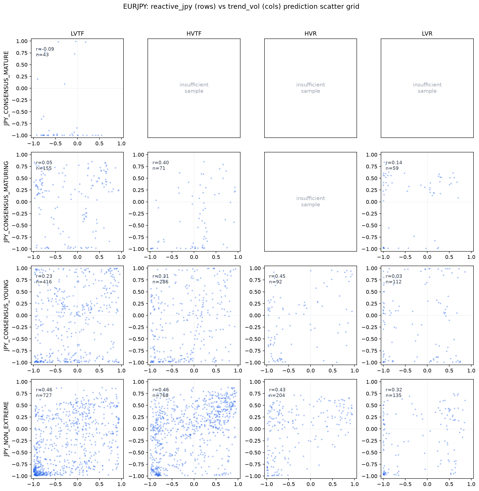

# Research State

**Last updated:** 11 October 2026  
**Reference dataset:** `1.6.1`  
**Current focus:** Persistent Commitment-Lifecycle surface research, reference-model evaluation, and downstream strategy screening.

This document is intentionally evidence-centric. It summarizes the current body of evidence rather than the history of how it was obtained. Experimental details, statistical analyses, implementation notes, and individual study protocols belong in the corresponding research documents and findings register.

## Purpose

This document summarizes the current scientific state of the Market Sentiment ML (MSML) research programme. It records current evidence, established findings, open questions, and immediate priorities. It is not a complete experiment chronology.

For implementation details, see `README.md`, `PROJECT_DESCRIPTION.md`, and `docs/`. For study-level evidence, consult the findings register and the research documents listed below.

---

## Executive Summary

The programme has moved from treating retail positioning as a direct predictive signal toward investigating whether its temporal and relational organization can be transformed into useful behavioral representations.

The central working proposition is that **retail positional information contains latent behavioral organization that can be transformed into predictive representations useful for downstream machine learning and adaptive decision-making**. This is a research-supported direction, not a claim that the current candidate ontology is conclusively validated or universally profitable.

Reactive-JPY remains the first complete Behavioral Surface and an important reference ontology. Since July, the Persistent family has progressed from behavioral discovery and lifecycle analysis to a candidate **Persistent Commitment-Lifecycle Surface v0.1.0**. The candidate has been constructed around Commitment Level and Commitment Trajectory, implemented through an expanded Behavioral Surface Validation Engine (BSVE), tested with coverage-aware calibration and validation procedures, used to train reference artifacts in MSML, and evaluated downstream in MPML. Strategy-level screening is now underway.

The current Persistent surface is already useful as a research and modelling representation: it makes behavioral organization explicit, enables reproducible state-conditioned modelling, and provides structured inputs for downstream evaluation. At the same time, its status must remain accurately qualified: it is a **candidate surface under ongoing research**, and evidence for representation usefulness is stronger than evidence for a universal or causal improvement in trading outcomes.

The main research questions are now:
- How robust and generalizable is the candidate surface under additional validation and data conditions?
- Do its states support predictive learning beyond appropriate controls?
- When and where do the resulting prediction artifacts improve adaptive strategy decisions?
- Which observed effects are stable, pair-specific, state-specific, or architecture-dependent?
- What mechanisms could explain the observed behavioral organization?

---

## Behavioral Surface Predictive Learning

Earlier Reactive-JPY work compared reference models under independent walk-forward evaluation and across MLP and LSTM architectures. Those experiments reported predictive differences across behavioral states and between model/control configurations. The results motivated evaluation of behavioral specialization as a way to organize learning, rather than assuming that raw sentiment levels themselves carry a universal predictive signal.

The Persistent research programme extends that direction to a distinct behavioral family and a different candidate ontology. MSML reference artifacts have been trained for the Persistent Commitment-Lifecycle states and for Persistent Trend/Volatility environments. MLP/LSTM comparisons show strong agreement in the direction of pair/configuration responses: reported ΔSharpe correlations are Pearson 0.917 and Spearman 0.865, with matching direction in 84 of 85 pair-by-configuration comparisons. Pair-level mean responses are also highly correlated (0.996). These are useful reproducibility indicators across the tested architectures; they do not prove that the surface causes improved prediction or that all states generalize equally well.

The current evidence supports continuing predictive evaluation of behavioral representations. Claims should remain scoped to the datasets, pairs, model configurations, validation designs, and metrics actually tested.

---

## Behavioral Representation Diversity

Prior prediction-artifact comparisons between Reactive-JPY and Trend/Volatility representations found that their predictions were not simply interchangeable partitions of one common signal. The Persistent programme adds another candidate representation and broadens the comparison space.

Across the current Persistent reference-model experiments, responses vary by pair and configuration. The synthesis reports positive mean responses for EURAUD and NZDUSD, a smaller positive response for GBPUSD, and negative responses for EURGBP and EURUSD in the current matrix. Trend/Volatility feature-set contrasts are mixed; in the four-environment LSTM comparison, mean ΔSharpe is approximately -0.008. These patterns argue against treating a behavioral surface as uniformly beneficial across instruments or model settings.

A similar subfamily pattern is also visible in the control/baseline results. The current baseline pair-level Sharpe values are EURAUD +0.146, EURGBP −0.218, EURUSD −0.178, GBPUSD +0.034, and NZDUSD −0.031. The similarity in signs and relative pattern means that the observed pair grouping cannot yet be attributed specifically to the Persistent surface or its learned representations. One plausible explanation is the evaluation setup itself: the two evaluation strategies and the PhaseAware combinations used by the MPML dynamic selector may contribute to this structure. Different PhaseAware combinations are currently being evaluated, so this remains an active confound to investigate rather than a settled explanation. For that reason, pair-level response patterns should be compared against matched baselines and across selector/strategy configurations before being interpreted as surface-specific effects.

Prediction diversity and downstream operational effects are separate forms of evidence. Distinct prediction artifacts may be useful even when aggregate trading metrics are mixed, but their practical value must be evaluated in the downstream decision process rather than inferred from prediction diversity alone.

---

## Representative Prediction Artifact Comparison

A complementary prediction-level analysis examined whether independently constructed behavioral representations produce genuinely different predictive outputs. The original comparison used prediction artifacts exported by MSML before MPML routing, strategy selection, or downstream evaluation logic. It compared models trained using the Reactive-JPY Behavioral Surface with models trained using the traditional Trend/Volatility Behavioral Surface, restricted to timestamps where both produced valid predictions. This helps separate differences originating in the predictive-learning process from effects introduced later by adaptive selection.

**Figure 1. Representative Prediction Artifact Comparison (EURJPY).** Rows correspond to behavioral states within the Reactive-JPY ontology; columns correspond to Trend/Volatility states. Each subplot compares prediction values from the two independently trained models for timestamps where both surfaces produced a valid prediction. Pearson correlation is calculated only over observations within the corresponding state combination.

The original analysis reported that many state combinations showed little or no linear relationship, while moderate correlations remained diffuse rather than collapsing onto a single diagonal. Prediction confidence also differed between surfaces, producing distinct geometric structures rather than simple linear transformations. Together, these observations support the view that the two surfaces can encode different predictive representations, rather than merely alternative partitions of an identical signal.

This is evidence of prediction-level diversity, not by itself proof that either representation is more accurate, that the differences are caused uniquely by the ontology, or that they improve trading outcomes. The comparison is scoped to the Reactive-JPY and Trend/Volatility artifacts and the overlapping observations tested. Persistent reference-model and downstream results are summarized in the sections above and below; whether comparable diversity is useful across all Persistent states and settings remains an active question.

---

## Current Phase Supporting Documents

### Behavioral Representation and Persistent Research

- `FINDINGS_REGISTER.md` — current research findings and evidence status.
- `Persistent Family Research/` — phase-based record of the discovery, construction, and validation work.
- `PERSISTENT_BSVE_SURFACE_ROADMAP_final.md` — Persistent surface design and validation roadmap.
- `Persistent_Research_Synthesis_20261006.md` — synthesis of the Persistent research programme.
- `bsve/docs/persistent_findings.md` — Persistent-family empirical findings, where maintained in the working repository.
- `bsve/docs/reactive_jpy_findings.md` — Reactive-JPY ontology and validation findings.
- `bsve/docs/reactive_chf_findings.md` — exploratory Reactive-CHF work.

### Predictive and Downstream Evaluation

- `Persistent_MLP_MPML_Downstream_Evaluation.md` — MSML reference artifacts and MPML downstream evaluation.
- `persistent_strategy_screening_results_report.md` — current descriptive strategy-screening results.
- `docs/BSVE_MSML_integration_architecture.md` — behavioral surface integration into the predictive pipeline.
- `docs/integration/dl_prediction_artifacts.md` — prediction artifact schema and downstream contracts.

### Research Planning

- `docs/research/RESEARCH_STRATEGY.md` — research priorities and strategic direction.
- `PROJECT_DESCRIPTION.md` — scientific motivation and programme overview.

---

## Current Project Status

### Area Status

| Area | Status | Interpretation |
|---|---|---|
| Master research dataset and causal alignment | Stable; reference dataset `1.6.1` | Existing dataset validation and leakage controls remain foundational. |
| Retail sentiment as a direct predictor | Negative finding established | Raw sentiment has little reliable standalone predictive value under tested procedures. |
| Behavioral organization | Strong working evidence | Results support studying structured behavioral representations rather than raw sentiment alone. |
| Reactive-JPY ontology | Frozen reference ontology | First complete end-to-end BSVE example; its preregistered validation was formally inconclusive despite operational usefulness. |
| Persistent behavioral family | Substantial empirical evidence | Lifecycle and transition structure motivated construction of a dedicated candidate surface. |
| Persistent Commitment-Lifecycle surface | Candidate v0.1.0; ongoing research | Two dimensions and nine states; useful for reproducible modelling, not yet proven as a universal or causal ontology. |
| News association studies | Completed contextual analyses | Raw proximity did not exceed the empirical-calendar null; prior-exposure evidence was weak/inconclusive. |
| BSVE multi-surface support | Extended and operational | Surface contracts now support Persistent beyond the original Reactive-JPY use case. |
| Persistent validation/calibration | Completed for current candidate settings | Coverage-aware history resets, eligibility, and calibration sensitivity were assessed; one composition-adjusted temporal audit remains incomplete. |
| MSML Persistent reference artifacts | Trained | MLP/LSTM artifacts enable controlled pair/state/configuration comparisons. |
| MPML Persistent integration | Operational | Reference artifacts are consumed downstream; effects are heterogeneous and not by themselves causal evidence. |
| Strategy-level screening | In progress | Descriptive trade-level results identify candidates for stricter follow-up evaluation. |
| Agent-based modelling | Exploratory | Mechanistic explanation remains open and separate from empirical/predictive validation. |

### Research Infrastructure

The infrastructure required for this phase is operational: dataset validation and leakage auditing, artifact versioning, deterministic behavioral representation generation, generalized surface contracts, coverage-aware eligibility and calibration, reference-model training, and reproducible downstream evaluation. Infrastructure maturity should not be conflated with scientific confirmation of every surface hypothesis.

---

## Methodological Infrastructure

The Behavioral Surface Validation Engine (BSVE) separates behavioral representation construction and validation from predictive modelling. It supports deterministic state assignment, surface generation, calibration, explicit artifact contracts, independent checks, and dataset augmentation. It has been extended beyond Reactive-JPY to support surfaces with different semantics, including the Persistent Commitment-Lifecycle candidate.

For Persistent, the reference representation uses two dimensions:
- **Commitment Level:** `prior_mean_depth`
- **Commitment Trajectory:** `early_late_commitment_delta`

Their discretization yields nine states in candidate surface v0.1.0. The representation was evaluated across five pairs: EURAUD, EURGBP, EURUSD, GBPUSD, and NZDUSD. The BSVE work explicitly accounts for gaps in source observations: long gaps create segment boundaries and reset history rather than being interpolated across. Calibration and sensitivity analyses retained all five pairs and all nine states across the tested settings, although stricter eligibility thresholds reduce the available population.

These procedures support reproducible construction and coverage-aware use of the candidate. They do not, by themselves, establish that the chosen dimensions are uniquely correct, that all state interpretations are mechanistically true, or that any downstream performance difference is caused by the surface.

---

## Established Scientific Findings and Current Evidence

The findings below distinguish negative results, evidence supporting a research direction, and claims that remain provisional. “Established” here means supported within the tested scope, not universally true across all instruments or conditions.

### Retail Sentiment

Early research tested retail positioning as a direct predictive signal. Independent validation found little standalone predictive power; apparent pipeline-based effects did not survive raw-signal, shift, and shuffle checks. Simple additive price-plus-sentiment formulations destroyed rather than improved the tested price-based signal, while a simple extreme-regime filter showed no measurable improvement over price-only.

These results reject a simple, universal sentiment-alpha interpretation under the tested formulations. They do **not** show that positional information is useless. Rather, they motivated a different question: whether the sequence, persistence, and transitions of positional observations contain organization that is obscured when the data are treated as raw scalar features.

The accumulated Persistent work supports that latter direction. It has produced a deterministic, testable candidate representation and downstream model artifacts. The appropriate current statement is that the evidence indicates latent behavioral organization in retail positional information that can be operationalized into potentially useful predictive representations—not that all predictive or trading claims are already proven.

### Behavioral Organization and Pair Families

Multiple analyses have identified repeatable differences among FX pair families and motivated family-specific behavioral models. The Persistent family shows long-lived organization and lifecycle structure rather than only isolated sentiment effects. Transition and lifecycle information has proved more informative for constructing the current representation than raw positioning levels alone.

This evidence supports family-aware representation research. It does not imply that pair-family assignments are immutable, that all pairs share identical dynamics, or that observed organization has a single established mechanism.

### Persistent Commitment-Lifecycle Surface

The current Persistent candidate is built from Commitment Level and Commitment Trajectory, producing nine states. It is the result of a research sequence spanning behavioral discovery, lifecycle and commitment analysis, dimensional reduction, surface construction, family-level validation, coverage-aware BSVE validation, and calibration sensitivity checks.

The candidate is already useful in several concrete research senses:
- it turns a complex temporal behavioral hypothesis into deterministic, auditable state assignments;
- it permits state-conditioned MSML training and comparison across pairs and architectures;
- it supports controlled export of prediction artifacts into MPML;
- it makes state coverage, history eligibility, and downstream behavior measurable;
- it enables explicit tests of whether a behavioral representation helps adaptive decision-making.

The candidate should nevertheless remain labeled **v0.1.0 / under ongoing research**. Validation and calibration show that the surface can be constructed and used consistently under the tested rules; they do not amount to final proof of ontology validity, causal interpretation, universal generalization, or profitability.

### Persistent News Association

Two contextual studies investigated whether news exposure was associated with Persistent episode exits and subsequent event response.

In P0C-3, 61.79% of 1,416 exits had relevant news in the examined interval, but the observed exposure was not significantly above the empirical-calendar permutation null (observed 61.79% versus null mean 61.14%, `p = 0.289`). High-impact news exposure also did not exceed the null (`p = 0.157`). In P0C-4A, prior exposure had nominal evidence at a six-hour window (`LR = 3.90`, `p = 0.048`), but was weaker at twelve hours (`LR = 3.31`, `p = 0.069`); high-impact status and the exposure-by-impact interaction were unsupported.

The studies therefore do not establish an independent news-conditioned behavioral mechanism. News remains contextual evidence, while age-dependent persistence and lifecycle organization remain the more useful working frame.

### Coverage, Eligibility, and Calibration

BSVE validation explicitly considered source-data gaps and minimum-history requirements. Long gaps were treated as segment boundaries, with history reset rather than continuity assumed. Episode-level calibration excluded episodes that crossed long gaps; observation-level eligibility depended on sufficient Level and Trajectory history.

Under the reference minimum-history settings (Level ≥3 and Trajectory ≥4), 12,078 of 16,204 observations met joint eligibility (74.54%) in the broad eligibility assessment. The later reference calibration population comprised 8,630 eligible observations, 1,060 eligible segments, and 436 eligible canonical episodes across five pairs and all nine states. The different counts refer to different stages/populations and should not be treated as contradictory estimates of one identical sample. Sensitivity checks using stricter history thresholds reduced coverage while retaining all pairs and states.

The intended composition-adjusted temporal audit P0C-5F.3.4 did not complete: part of its source population could not be uniquely reconstructed from available provenance. This is an unresolved audit limitation, not a negative scientific result. Findings from the completed temporal audit and the later BSVE coverage/calibration work should be interpreted within their stated populations.

### MSML Reference Models

Persistent MLP and LSTM reference artifacts have been trained for the candidate behavioral states and comparison configurations. Across 85 pair-by-configuration comparisons, the reported ΔSharpe responses agreed in direction in 84 comparisons; their cross-architecture correlation was Pearson 0.917 and Spearman 0.865. Pair-level mean responses correlated at 0.996.

These results support using the artifacts for controlled downstream comparison and suggest that many pair/configuration response patterns are not specific to one architecture. Responses are heterogeneous: the current matrix reports positive mean responses for EURAUD and NZDUSD, smaller positive responses for GBPUSD, and negative responses for EURGBP and EURUSD. The tested Trend/Volatility feature-set contrast is mixed. These findings do not show that every behavioral state adds value or that architectural agreement alone establishes predictive superiority.

### MPML Downstream Evaluation

Persistent artifacts have been consumed by MPML, enabling evaluation of their effects on selector behavior and downstream strategy outcomes. In the reported benchmark, DL was available on 4,418 observations and 786 selector interventions occurred (17.79%). Across state/pair cells, mean incremental return was approximately neutral, with a modestly positive mean incremental Sharpe but a median of zero. Effects varied across pairs, folds, and states.

This indicates that the artifacts can participate in and affect adaptive selection, but the observed benchmark does not establish uniform portfolio-level improvement or a causal benefit attributable solely to the surface. Sparse DL coverage and the conditional nature of selector interventions matter when interpreting aggregate metrics.

### Strategy-Level Screening

The current screening report covers 180 runs: 10 baseline runs, 90 Persistent behavioral runs, and 80 Persistent Trend/Volatility runs. The trade artifacts contain 2,586 behavioral records and 7,316 Trend/Volatility records.

MR1 showed positive mean trade return in all nine Persistent behavioral states, including states with at least ten eligible trades; MR5, MR32, and MR42 also showed positive state-average returns, with differing consistency. This is a useful screening result and justifies more targeted evaluation. It is not yet evidence of statistical significance, selector-level superiority, or portfolio profitability. Trade-level averages can be affected by sample size, dependence, selection, and the way trades are aggregated; follow-up tests must account for those issues.

In 40 matched Trend/Volatility comparisons, the `price_trend` and `trend_vol_only` outputs had identical reported counts and return statistics. This observation has not yet been explained and does not establish that the models' predictions are equivalent. It should be treated as a reproducibility/diagnostic question for follow-up.

### Reactive-JPY and Reactive-CHF

Reactive-JPY remains the first complete reference ontology, with deterministic lifecycle identification, calibrated maturity boundaries, hazard-rate analysis, and an operational BSVE workflow. Its preregistered behavioral validation was formally inconclusive, despite its value as a methodological and operational reference. That qualification should remain visible.

Reactive-CHF remains exploratory. Existing observations suggest volatility-related organization, but the ontology has not reached the same level of construction and evaluation as the current Persistent candidate or the Reactive-JPY reference.

---

## Current Confidence Assessment

| Research area | Current assessment | Basis and limitation |
|---|---|---|
| Dataset construction and causal alignment | High | Pipeline validation and leakage audits completed for the reference dataset. |
| Raw sentiment as a direct predictor | High confidence in the negative finding within tested formulations | Raw, shifted, and shuffled checks did not support the tested direct-signal claims; not every conceivable conditional use has been ruled out. |
| Latent behavioral organization in positional data | Strong supporting evidence; active research | Multiple analyses motivate reproducible behavioral representations; scope and generalization remain under test. |
| Persistent behavioral family | Strong empirical support | Repeated lifecycle and transition findings support dedicated representation work. |
| Persistent Commitment-Lifecycle surface v0.1.0 | Promising candidate; ongoing validation | Deterministic and operational, with calibration and downstream artifacts; not conclusively proven or universal. |
| Reactive-JPY ontology | Moderate; operational reference | Full workflow demonstrated, but preregistered validation remained formally inconclusive. |
| BSVE multi-surface methodology | High operational confidence | Successfully extended to Persistent; population/provenance limitations remain for one incomplete audit. |
| MSML architecture agreement | Strong within tested comparisons | MLP/LSTM responses agree in direction in 84/85 comparisons; this is not proof of absolute predictive improvement. |
| MPML adaptive value | Preliminary and heterogeneous | Selector interventions and metric changes observed; mean incremental return approximately neutral and no causal claim established. |
| Strategy-level Persistent screening | Preliminary | Encouraging descriptive patterns nominate candidates; significance and portfolio-level performance remain unestablished. |
| News-conditioned mechanism | Weak/inconclusive | Permutation null and follow-up exposure tests do not establish an independent news effect. |
| Mechanistic interpretation (ABM) | Open / exploratory | Mechanisms remain to be tested against the empirical lifecycle and family evidence. |

---

## Open Scientific Questions

### Behavioral Representation

- How stable is the Persistent Commitment-Lifecycle surface under additional samples, periods, pairs, and calibration choices?
- Are the two current dimensions sufficient, or do additional dimensions materially improve representation?
- Which aspects of the surface generalize across pair families, and which remain family-specific?
- How should confidence and uncertainty in state assignment be represented?

### Behavioral Dynamics

- Are observed family characteristics stable or do pairs transition between behavioral organizations?
- Which lifecycle and transition properties are robust across market environments?
- How do missing coverage and history eligibility affect interpretation of episode-level results?
- Which mechanisms govern transitions and dissolution?

### Predictive Learning

- Do Persistent states improve learning over well-matched non-surface controls under leakage-safe walk-forward evaluation?
- Which architectures and state/configuration combinations benefit, and are effects stable across folds and pairs?
- How should architecture agreement, prediction diversity, and state-level performance be combined without overstating evidence?
- Why are `price_trend` and `trend_vol_only` outputs identical in the matched screening cases?

### Adaptive Decision-Making

- Under what conditions do Persistent artifacts alter selector choices and improve realized outcomes?
- Which screening findings survive uncertainty estimates, dependence-aware inference, and realistic execution assumptions?
- Are benefits concentrated in specific pairs, states, strategies, or periods?
- How should sparse model availability and intervention rates be reflected in downstream evaluation?
- Can multiple behavioral surfaces be combined or selected adaptively without hindsight bias?

### Mechanistic Understanding

- Can interacting-agent models reproduce the observed Persistent lifecycle and state structure?
- Which empirical findings remain unexplained by current ABM mechanisms?
- Can a duration-dependent dissolution mechanism account for the observed age-related lifecycle patterns?

---

## Current Research Priorities

### Priority 1 — Continue validation of the Persistent candidate

Preserve v0.1.0 as a stable reference while clearly recording limitations. Complete or explicitly retire the unresolved P0C-5F.3.4 audit once the population provenance issue is resolved. Continue robustness checks without retroactively changing the reference surface based on downstream outcomes.

### Priority 2 — Strengthen predictive evaluation

Compare Persistent state-specialized models with appropriate baselines under matched, leakage-safe walk-forward protocols. Report pair/state sample sizes and uncertainty, and distinguish architecture reproducibility from absolute predictive superiority.

### Priority 3 — Evaluate strategy-level findings rigorously

Use current screening results to prioritize follow-up tests, not to declare winners. Evaluate robustness across folds and pairs, account for dependent trades and multiple comparisons, and separate trade-level summaries from selector-level and portfolio-level outcomes.

### Priority 4 — Understand representation diversity and multi-surface use

Compare prediction artifacts and downstream behavior across Persistent, Reactive-JPY, and Trend/Volatility representations. Determine whether diversity contributes incremental decision value, and evaluate any surface-selection logic without using future outcomes to select states or models.

### Priority 5 — Mechanistic explanation

Continue ABM as a separate line of inquiry. Mechanistic claims should be tied to explicit empirical targets and remain distinct from evidence that a representation is operationally useful.

---

## Immediate Research Direction

The immediate programme is not simply to discover more behavioral phenomena or to wait for a perfect ontology. It is to **use the current candidate surface as a testable research instrument while continuing to challenge and refine it**.

The current evidence supports the proposition that retail positional information contains latent behavioral organization and that this organization can be represented deterministically, used to train predictive models, and evaluated in an adaptive decision pipeline. The remaining work is to determine how robust, incremental, and decision-relevant that information is across settings—and to quantify the limits as carefully as the positive findings.

## Closing Remarks

The project has progressed from testing sentiment as a direct predictor to treating positional data as observations of potentially structured behavior. The Persistent Commitment-Lifecycle surface v0.1.0 is an important, useful candidate in that transition: it makes a behavioral hypothesis explicit and enables reproducible downstream experiments. Its value should be reported now, alongside the uncertainty and limitations that remain, rather than withheld until every question is resolved.

For programme history and implementation guidance, see `PROJECT_DESCRIPTION.md`, `docs/research/RESEARCH_STRATEGY.md`, and the current findings register.
